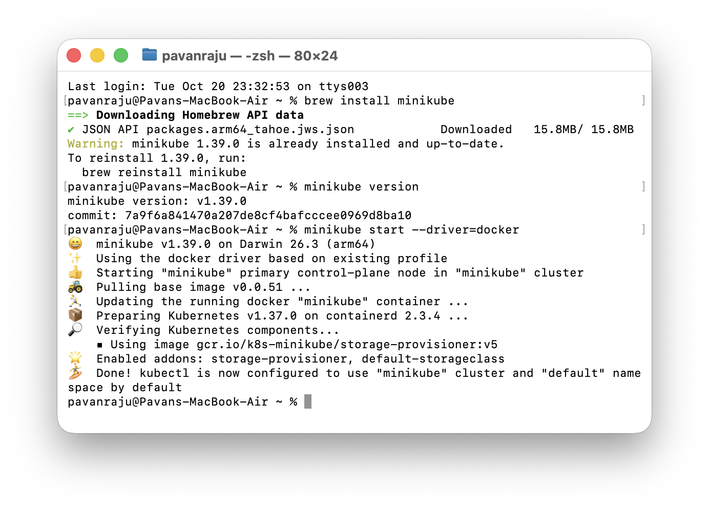
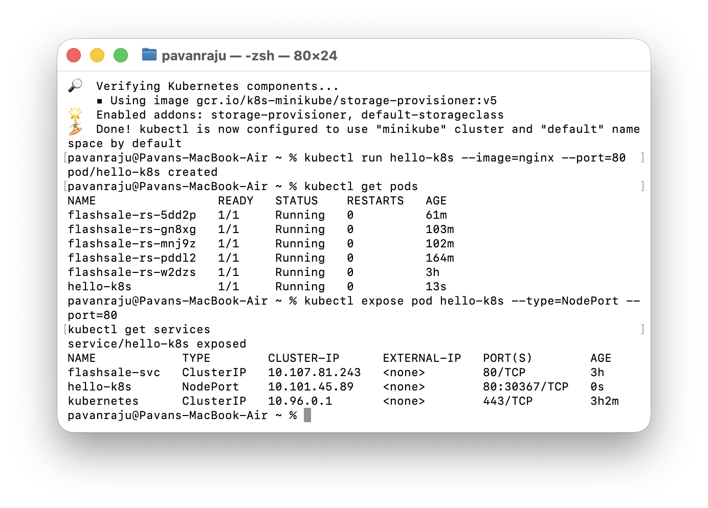
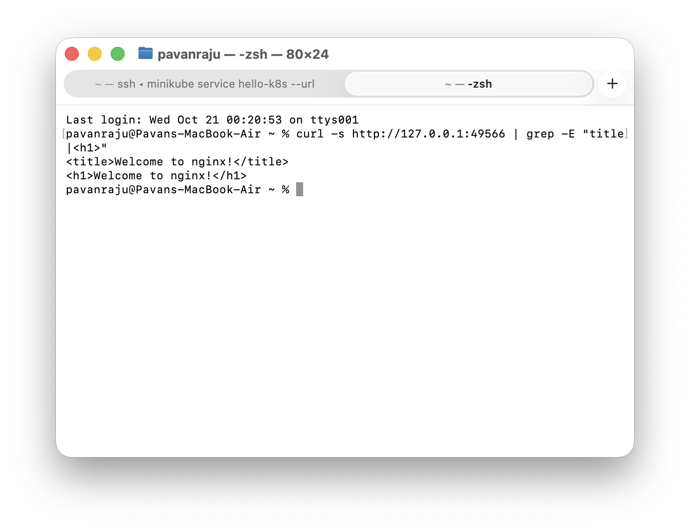

# Exercise 1: Kubernetes Getting Started

## Objective
Deploy an Nginx application as a Kubernetes Pod using Minikube and verify that it is running successfully.

## Steps

### 1. Install Minikube
    brew install minikube

### 2. Start Minikube
    minikube start --driver=docker

### 3. Create the Nginx Pod
    kubectl run hello-k8s --image=nginx --port=80

### 4. Verify the Pod
    kubectl get pods

### 5. Expose the Pod
    kubectl expose pod hello-k8s --type=NodePort --port=80
    kubectl get services

### 6. Access the Nginx Application
    minikube service hello-k8s --url

## Result
Successfully deployed and accessed an Nginx application using Kubernetes and Minikube.
