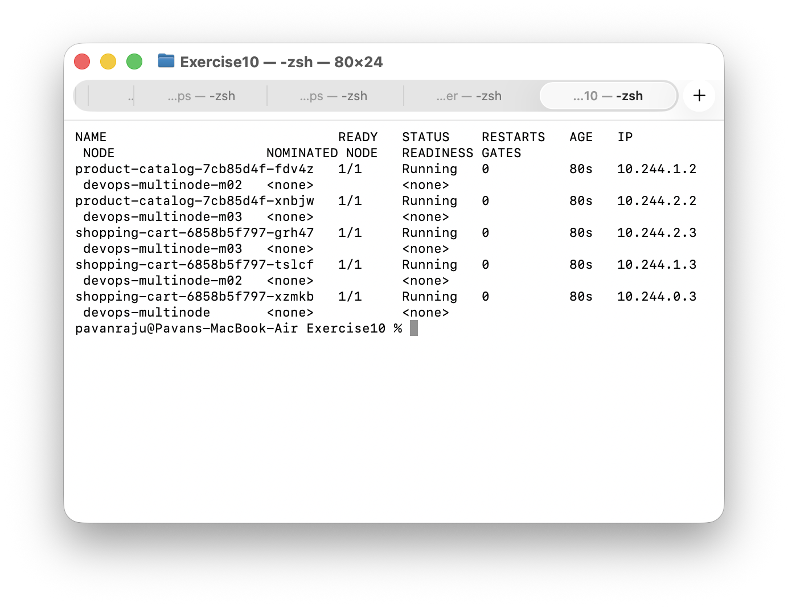
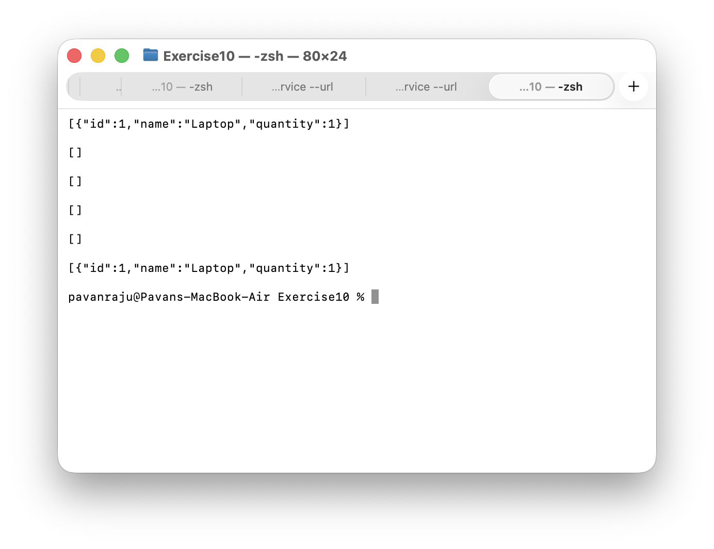

# Exercise 10: Multi-Node Kubernetes Cluster with Multiple Applications and ReplicaSets

## Objective
Run a 3-node Minikube cluster and deploy two Flask services on it: a Product Catalog with 2 replicas and a Shopping Cart with 3 replicas. A pod anti-affinity rule keeps replicas of the same app on different nodes, so one node failing does not take a whole service down.

## Environment
- MacBook Air (Apple M2, 8 GB RAM), macOS
- Docker Desktop (memory limit raised to about 5 GB, see Deviations)
- Minikube v1.39.0, Docker driver, containerd runtime
- Kubernetes v1.37.0 (chosen by Minikube)
- Profile name: devops-multinode, 3 nodes (devops-multinode, devops-multinode-m02, devops-multinode-m03)
- Images based on python:3.9-slim with the latest Flask

## Tasks / Steps

### 1. Clean up and start the cluster
I deleted the old single-node minikube profile and stopped my Jenkins container to free memory. Then I started the 3-node cluster:

    minikube delete
    minikube start --nodes 3 -p devops-multinode --memory 1400 --cpus 2 --force
    kubectl get nodes -o wide

All three nodes showed Ready.

### 2. Create the applications and Dockerfiles
product_catalog.py serves GET /products. shopping_cart.py serves GET and POST /cart and keeps the cart in a Python list in memory. Dockerfile.product and Dockerfile.shopping copy each file into python:3.9-slim, install Flask and run the script.

### 3. Build the images and load them into all nodes

    docker build -t product-catalog:latest -f Dockerfile.product .
    docker build -t shopping-cart:latest -f Dockerfile.shopping .
    minikube -p devops-multinode image load product-catalog:latest
    minikube -p devops-multinode image load shopping-cart:latest
    minikube -p devops-multinode ssh -n devops-multinode-m03 -- sudo crictl images | grep -E "product-catalog|shopping-cart"

The crictl check on the worker node m03 listed both images, which is needed because the pods use imagePullPolicy: Never.

### 4. Deploy the applications and services

    kubectl apply -f product_catalog_deployment.yaml
    kubectl apply -f shopping_cart_deployment.yaml
    kubectl apply -f product_catalog_service.yaml
    kubectl apply -f shopping_cart_service.yaml
    kubectl get pods -o wide
    kubectl get svc

Both Deployments use requiredDuringSchedulingIgnoredDuringExecution pod anti-affinity with topologyKey kubernetes.io/hostname, so no two pods of the same app can share a node. Both Services are of type NodePort.

### 5. Verify the distribution
All 5 pods are 1/1 Running. The two product-catalog pods run on m02 and m03. The three shopping-cart pods run on m03, m02 and the control-plane node, so each of the 3 nodes has one shopping-cart pod.

### 6. Access and test the services
On macOS with the Docker driver the node IPs are not reachable from the host, so I used a tunnel. Each command was left running in its own Terminal tab:

    minikube -p devops-multinode service product-catalog-service --url
    minikube -p devops-multinode service shopping-cart-service --url

This gave local URLs http://127.0.0.1:50044 (product catalog) and http://127.0.0.1:50053 (shopping cart). Test results:

    curl http://127.0.0.1:50044/products
    [{"id":1,"name":"Laptop","price":1200},{"id":2,"name":"Phone","price":800},{"id":3,"name":"Headphones","price":150}]

    curl http://127.0.0.1:50053/cart
    []

    curl -X POST http://127.0.0.1:50053/cart -H "Content-Type: application/json" -d '{"id": 1, "name": "Laptop", "quantity": 1}'
    [{"id":1,"name":"Laptop","quantity":1}]

    curl http://127.0.0.1:50053/cart
    []

The last GET returned an empty cart because the Service sent it to a different pod from the one that received the POST. To show this, I ran the GET six times in a loop. Only some responses contain the item:

## Deviations and honest notes
- The Mac has 8 GB of RAM and Docker Desktop was limited to about 3.8 GB, which is too little for three nodes. I raised the Docker memory limit to 5120 MiB by adding MemoryMiB to Docker's settings-store.json, after which Docker reported about 4.8 GB.
- I started the nodes with --memory 1400 --cpus 2 and --force. The exercise used only --force, because it ran as root on Linux. Here --force is needed because 1400 MB is below Minikube's recommended minimum.
- I did not enable the registry addon. The images were put on every node with minikube image load, which was enough and saved memory.
- The cluster uses containerd, so I checked the images with crictl images on a node instead of ssh -- docker images.
- In the exercise, shopping_cart_deployment.yaml uses the namespace devops-exercise while its Service is in default. The Service would not find the pods, so I used default for everything.
- Minikube installed Kubernetes v1.37.0, not the v1.31.0 shown in the exercise's sample output.
- Flask is not pinned in the Dockerfiles, as in the exercise, so the latest version was installed.
- The service URLs and ports (50044 and 50053) come from minikube service tunnels on this Mac and differ from the exercise's example ports.
- The cart is stored in memory inside each pod, so with 3 replicas the cart contents differ from pod to pod and are lost when a pod restarts. A real shopping cart would need shared storage such as a database or Redis.
- The pods screenshot is from an 80-column Terminal window, so the NODE column wraps onto a second line.
- I did not test node failure.

## Key Concepts
- Deployment and ReplicaSet: keep the requested number of identical pods running.
- Pod anti-affinity: required rules stop replicas of the same app from sharing a node, which is why the shopping-cart Deployment needs at least 3 nodes.
- NodePort Service: load-balances requests across all pods that match the selector.
- imagePullPolicy: Never: the image must already be present on every node, which minikube image load handles.
- Stateful versus stateless: an in-memory cart works only with one replica.

## Result
The 3-node cluster ran both applications with the requested replica counts. Anti-affinity placed the 2 product-catalog pods and the 3 shopping-cart pods on different nodes, and both services answered through their tunnels.
