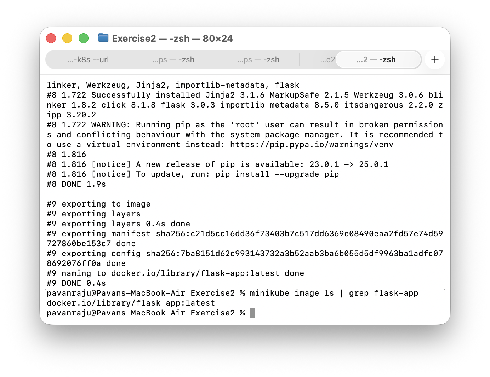
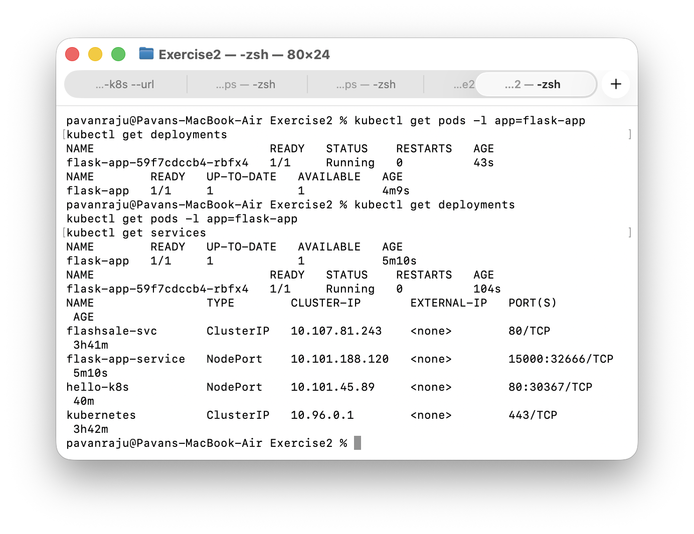
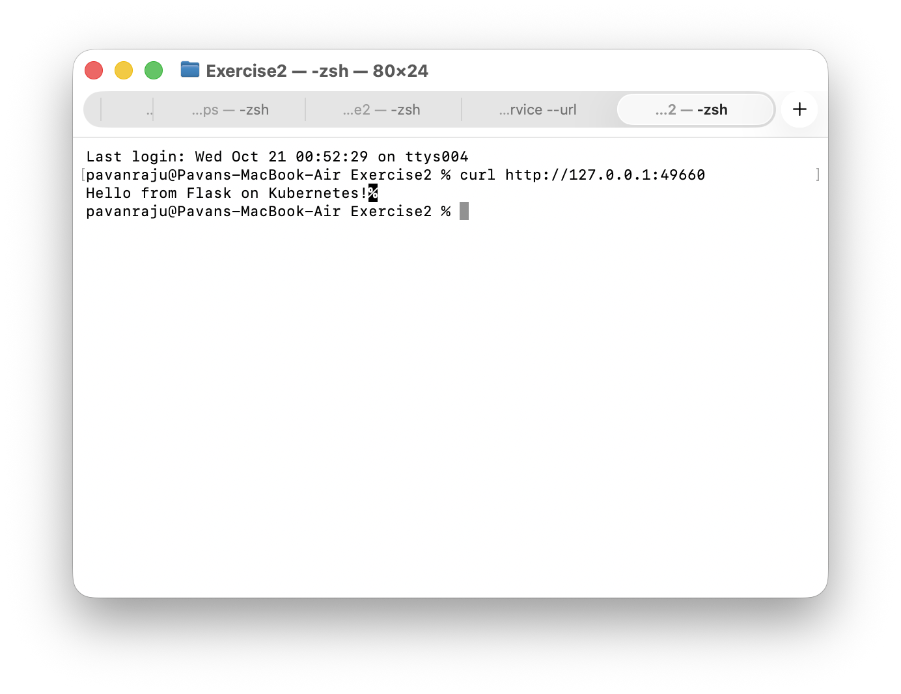
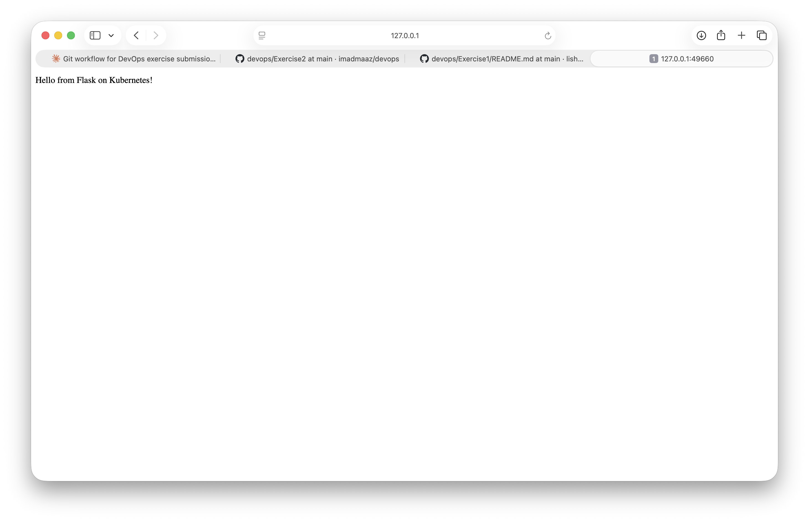

# Exercise 2: Deploy a Flask App on Minikube using kubectl and YAML

## Objective
Deploy a Python Flask application on a local Kubernetes cluster using Minikube, build the container image, and expose it through a Kubernetes Service.

## Environment
- macOS (Apple Silicon)
- Docker Desktop
- Minikube (containerd runtime)
- kubectl

## 1. Start Minikube
    minikube start

## 2. Create the Flask Application
File: app.py

## 3. Create the Dockerfile
File: Dockerfile

## 4. Build the Image for Minikube
Minikube runs on the containerd runtime, so a plain docker build is not visible to the cluster (the pod fails with ErrImageNeverPull). Building with Minikube puts the image where the cluster can use it.

    minikube image build -t flask-app .
    minikube image ls | grep flask-app

## 5. Create the Deployment and Service
File: flask-deployment.yaml

The Deployment uses imagePullPolicy: Never so Kubernetes uses the locally built image. The Service is a NodePort mapping port 15000 to the container port 15000.

## 6. Deploy the Application
    kubectl apply -f flask-deployment.yaml

## 7. Verify Deployment, Pods, and Service
    kubectl get deployments
    kubectl get pods -l app=flask-app
    kubectl get services

## 8. Access the Flask App
    minikube service flask-app-service --url
    curl http://127.0.0.1:<port>

## Result
Successfully built a Flask application image, deployed it to a local Kubernetes cluster with a Deployment, and exposed it through a NodePort Service. The app responded with "Hello from Flask on Kubernetes!" when accessed through the Minikube service URL.
