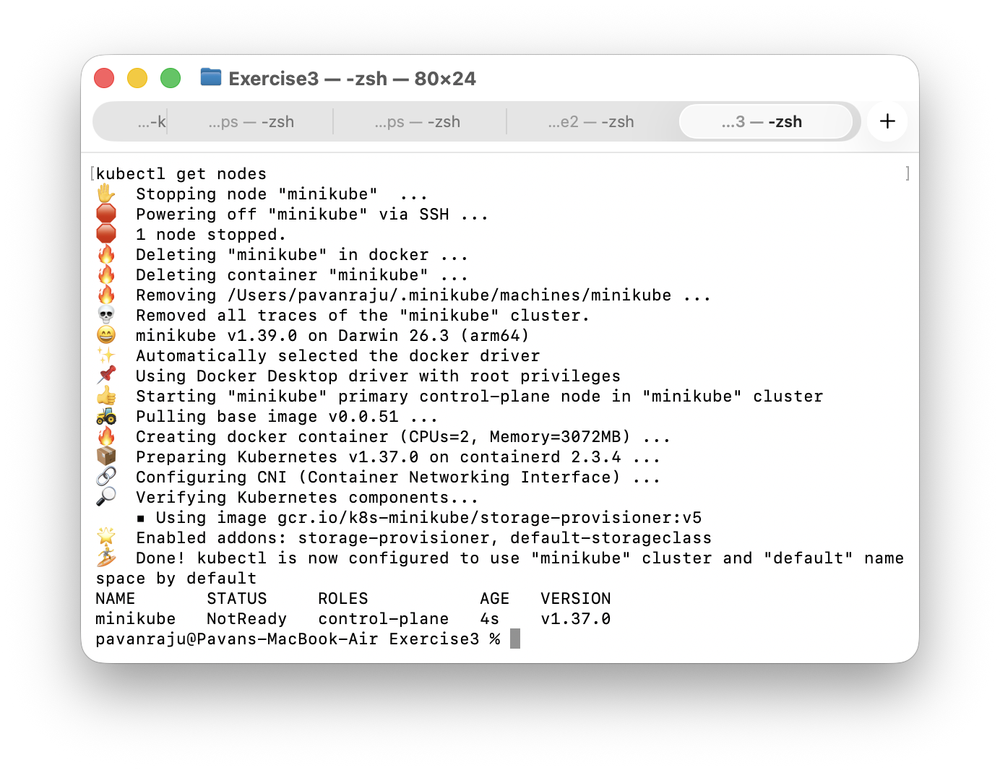
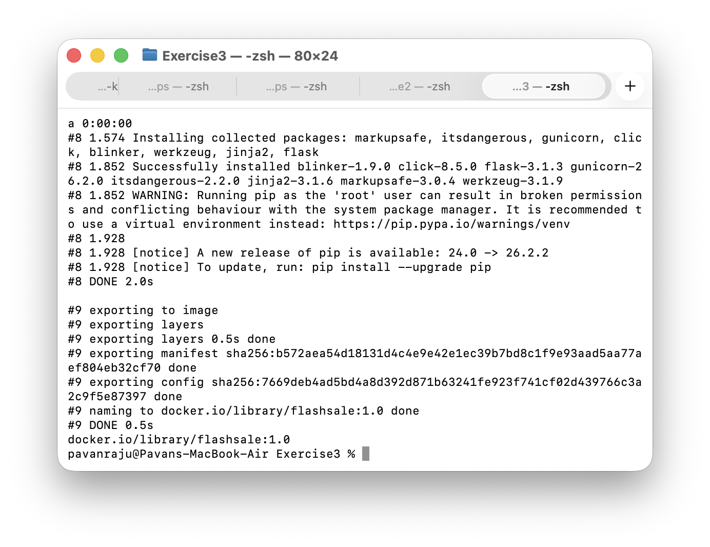
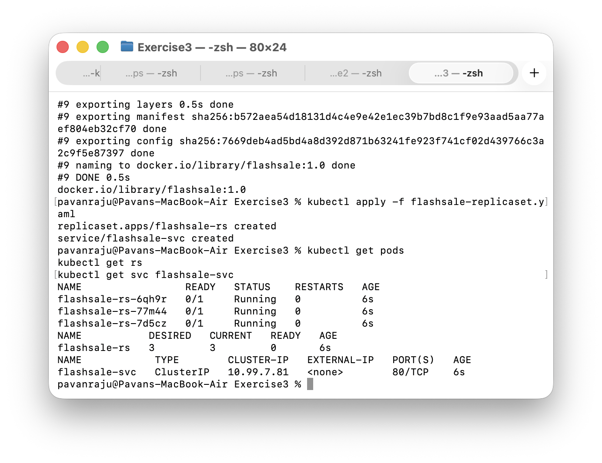
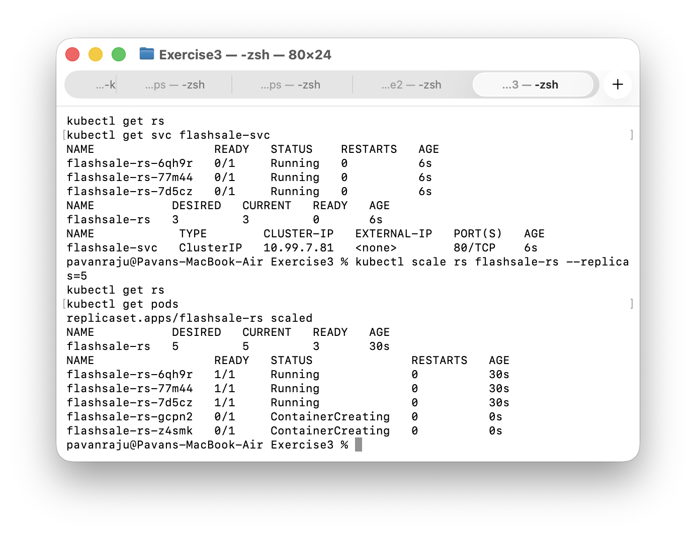
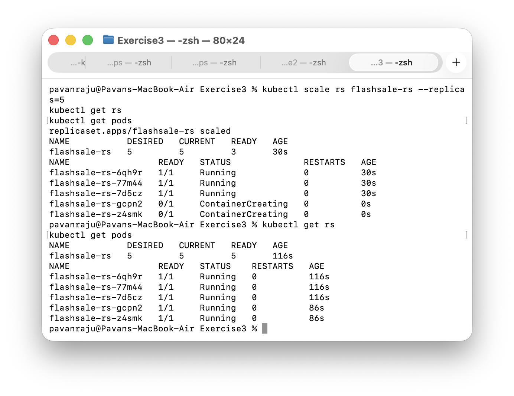
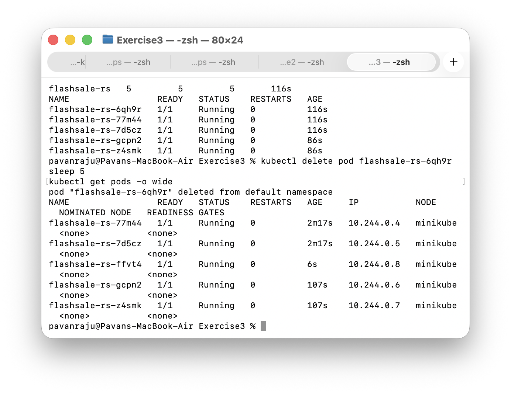

# Exercise 3: Scaling a Flask App on a Single Node Using ReplicaSets

## Objective
Understand how a Kubernetes ReplicaSet keeps a desired number of Pods running. Scale a Flask flash-sale app from 3 to 5 Pods and watch Kubernetes replace a Pod that is deleted.

## Environment
- macOS (Apple Silicon)
- Docker Desktop
- Minikube (single node)
- kubectl

## 1. The Flash Sale App
File: app.py

The app has three routes:
- / returns a welcome message with the name of the Pod that served it
- /buy returns a random item and the Pod that served it
- /health is used by the readiness and liveness probes

## 2. The Dockerfile
File: Dockerfile

The image runs the app with gunicorn on port 5000.

## 3. Reset Minikube and Start a Single Node
    minikube stop
    minikube delete
    minikube start --nodes=1
    kubectl get nodes

## 4. Build the Image
Minikube here uses the containerd runtime, so a normal docker build is not visible to the cluster. Building with Minikube makes the image available to the Pods.

    minikube image build -t flashsale:1.0 .
    minikube image ls | grep flashsale

## 5. Create the ReplicaSet and Service
File: flashsale-replicaset.yaml

The ReplicaSet requests 3 replicas, each with readiness and liveness probes on /health and CPU and memory requests and limits. It uses imagePullPolicy: Never so the locally built image is used. A ClusterIP Service (flashsale-svc) exposes the Pods on port 80.

    kubectl apply -f flashsale-replicaset.yaml
    kubectl get pods
    kubectl get rs
    kubectl get svc flashsale-svc

## 6. Scale to 5 Replicas
    kubectl scale rs flashsale-rs --replicas=5
    kubectl get rs
    kubectl get pods

Two new Pods were created and started.

Once they finished starting, the ReplicaSet reported 5 desired, 5 current and 5 ready.

## 7. Delete a Pod and Observe Self-Healing
    kubectl delete pod flashsale-rs-6qh9r
    kubectl get pods -o wide

The ReplicaSet created a replacement Pod straight away, which brought the count back to 5. All Pods ran on the single minikube node.

## Key Observations
- Pod distribution: every Pod is an identical copy of the app, so scaling just adds more copies.
- Resiliency: deleting a Pod did not reduce capacity, because the ReplicaSet replaced it automatically.
- Efficiency: Pods can be added when demand rises and removed when it drops.
- Single node: with one node, all 5 Pods were scheduled onto the same minikube node.

## Result
Successfully deployed a Flask flash-sale app as a ReplicaSet, scaled it from 3 to 5 Pods, and confirmed that a deleted Pod is replaced automatically.
