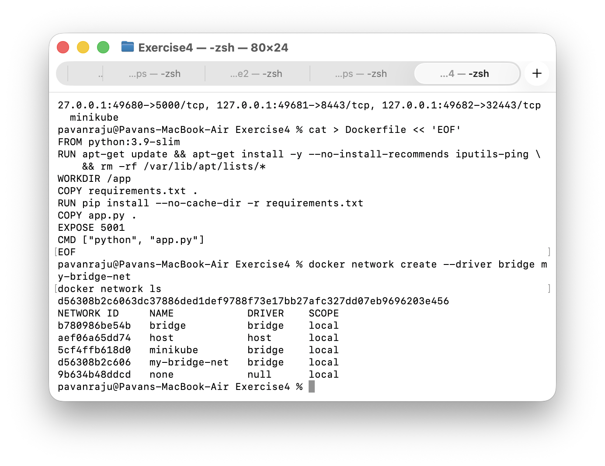
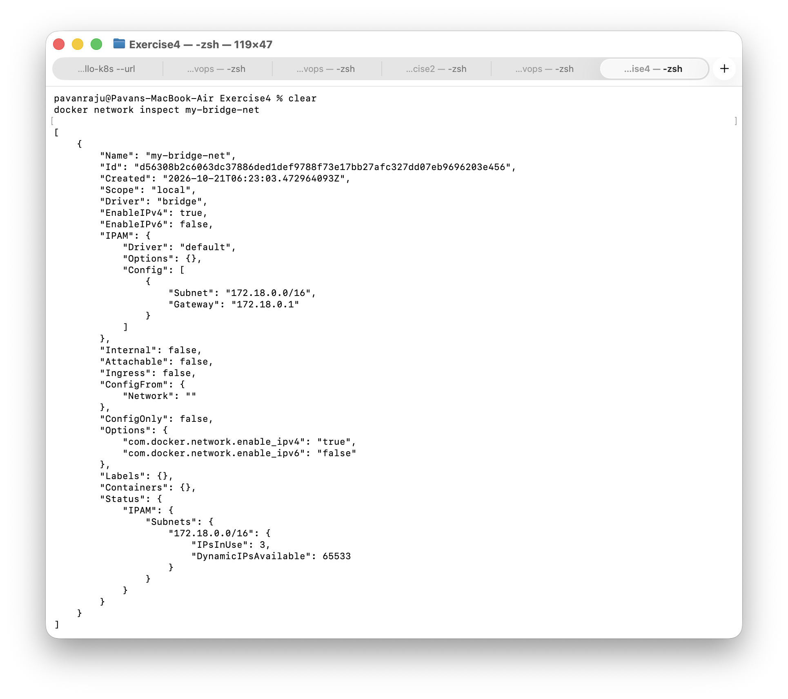
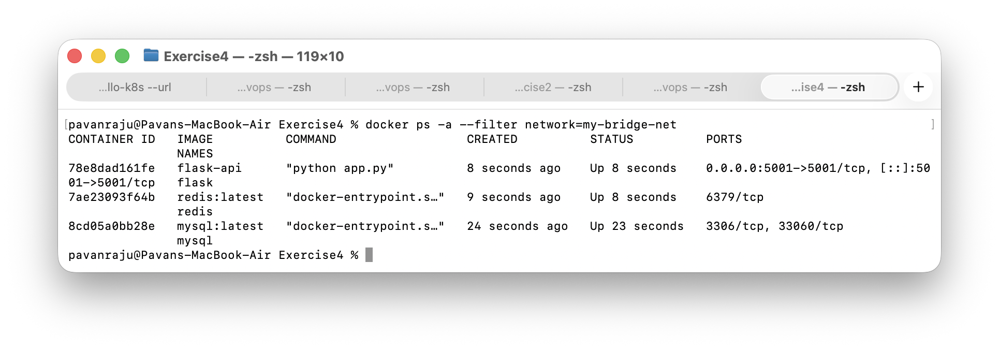
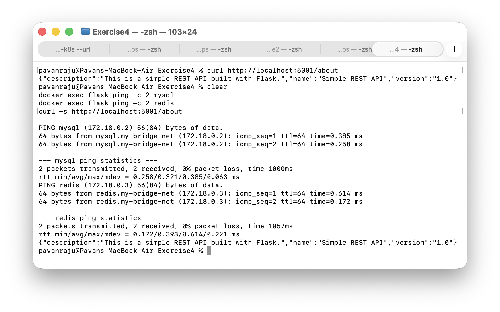
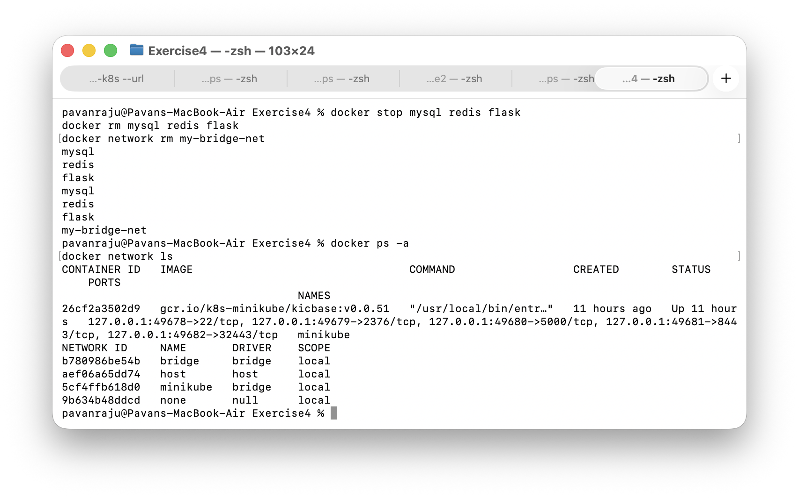

# Exercise 4: Docker Networking with Multiple Containers

## Objective
Understand Docker networking by running a multi-container application: a Flask web server, a MySQL database and a Redis cache, all communicating over a user-defined bridge network.

## Environment
- macOS (Apple Silicon)
- Docker Desktop

## Task 1 and 2: Create and Verify a Bridge Network
    docker network create --driver bridge my-bridge-net
    docker network ls

my-bridge-net appeared next to Docker's default networks, using the bridge driver with local scope.

## Task 3: Inspect the Network
    docker network inspect my-bridge-net

Docker gave the network its own subnet (172.18.0.0/16) and gateway (172.18.0.1).

## Task 4: Build and Launch the Containers
The Flask app (app.py) exposes a single /about route that returns JSON. Dependencies are in requirements.txt and the image is defined in the Dockerfile.

Note: requirements.txt pins Flask 2.0.1 as the exercise asks. That version breaks with the newest Werkzeug, so Werkzeug, Jinja2, itsdangerous and MarkupSafe are pinned to compatible versions too. The Dockerfile also installs iputils-ping so the connectivity test can use ping.

Build the Flask image:

    docker build -t flask-api .

Launch all three containers on the bridge network:

    docker run -d --name mysql --net=my-bridge-net -e MYSQL_ROOT_PASSWORD=rootpass mysql:latest
    docker run -d --name redis --net=my-bridge-net redis:latest
    docker run -d --name flask --net=my-bridge-net -p 5001:5001 flask-api

mysql:latest needs MYSQL_ROOT_PASSWORD (or an equivalent) or the container exits immediately.

All three containers reached the Up state on my-bridge-net:

    docker ps -a --filter network=my-bridge-net

## Task 5: Test Connectivity
From inside the Flask container, I pinged the other two containers by name. Docker's embedded DNS resolved both names to their bridge network IPs (mysql at 172.18.0.2 and redis at 172.18.0.3). The /about endpoint also returned the expected JSON from the host.

    docker exec flask ping -c 2 mysql
    docker exec flask ping -c 2 redis
    curl http://localhost:5001/about

## Task 6: Clean Up
    docker stop mysql redis flask
    docker rm mysql redis flask
    docker network rm my-bridge-net

## Key Concepts
- The --net flag connects a container to a specific Docker network instead of the default bridge.
- Container-to-container communication: containers on the same user-defined bridge network can reach each other by container name, thanks to Docker's embedded DNS.
- Bridge vs host network: a bridge network isolates containers on a private virtual network (reached from the host only through published ports). A host network shares the host's network directly, with no isolation or port mapping.
- Exposing a port to the host: the -p host-port:container-port flag publishes a container's port to the host machine.

## Result
Created a custom bridge network, ran Flask, MySQL and Redis containers on it, and confirmed that the containers can resolve and reach each other by name while the Flask API stays reachable from the host through its published port.
