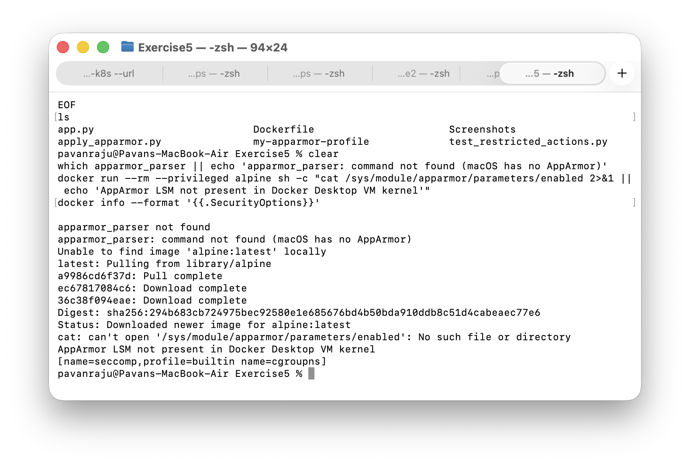
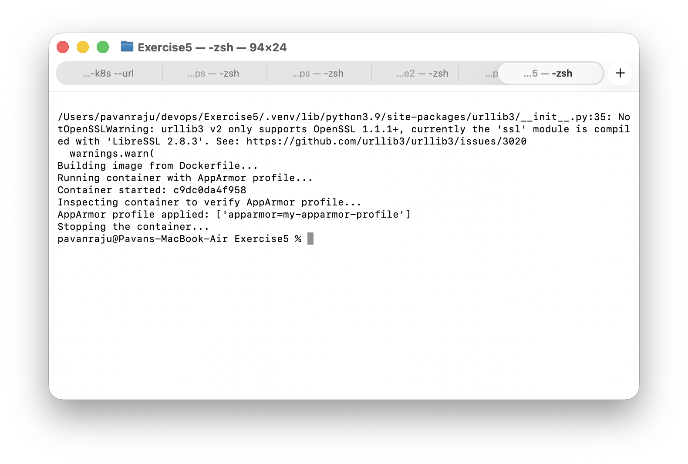
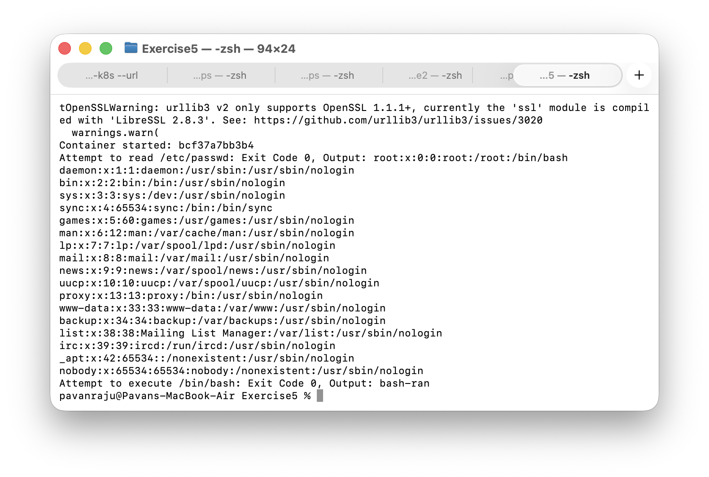
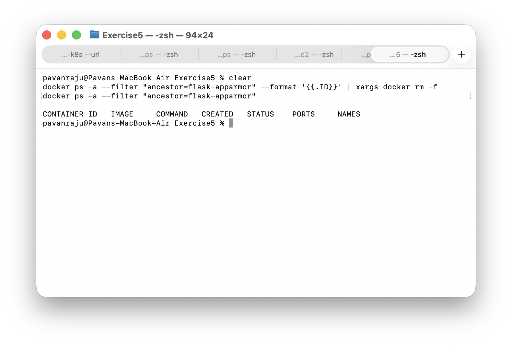

# Exercise 5: Docker Security with AppArmor and the Docker SDK for Python

## Objective

Attach a custom AppArmor profile to a Docker container using the Docker SDK for Python, then test whether restricted actions (reading `/etc/passwd` and executing `/bin/bash`) are blocked inside the container.

## Environment

- MacBook Air (Apple Silicon), macOS, zsh
- Docker Desktop for Mac
- Python 3.9.6 in a virtual environment (`.venv`)
- Docker SDK for Python 7.2.0 (with requests 2.32.5 and urllib3 2.6.3)

## Important Note: AppArmor Is Not Enforced on Docker Desktop for Mac

AppArmor is a Linux kernel security module. Docker Desktop for Mac runs containers inside a lightweight Linux VM whose kernel does not include AppArmor, so the profile name is accepted and attached to the container but is never enforced. As a result, both restricted actions succeeded with exit code 0 instead of being blocked. This README reports that result as it happened. On a Linux host with AppArmor enabled, the profile would first need to be loaded with `apparmor_parser`, and the same test would be expected to be denied.

## Tasks

### 1. Check the platform for AppArmor support

Commands run:

    which apparmor_parser || echo 'apparmor_parser: command not found (macOS has no AppArmor)'
    docker run --rm --privileged alpine sh -c "cat /sys/module/apparmor/parameters/enabled 2>&1 || echo 'AppArmor LSM not present in Docker Desktop VM kernel'"
    docker info --format '{{.SecurityOptions}}'

Result: `apparmor_parser` is not found, `/sys/module/apparmor/parameters/enabled` does not exist in the VM kernel, and Docker reports only `seccomp` and `cgroupns` as security options (no `apparmor`).

### 2. Attach the AppArmor profile using the Docker SDK

Set up the environment and run the script:

    cd ~/devops/Exercise5
    python3 -m venv .venv
    source .venv/bin/activate
    pip install docker
    python apply_apparmor.py

The script builds the image, runs a container with `security_opt=["apparmor=my-apparmor-profile"]`, inspects the container, and confirms the option was applied: `['apparmor=my-apparmor-profile']`. The `NotOpenSSLWarning` shown in the output comes from Python 3.9 on macOS being built against LibreSSL; it does not affect the result.

### 3. Test the restricted actions

    python test_restricted_actions.py

The script starts a container with the profile attached, then tries to read `/etc/passwd` and to execute `/bin/bash`. Both returned exit code 0: the file contents were printed and bash ran (`bash-ran`). This confirms the profile is attached but not enforced on this platform.

### 4. Clean up

    docker ps -a --filter "ancestor=flask-apparmor" --format '{{.ID}}' | xargs docker rm -f
    docker ps -a --filter "ancestor=flask-apparmor"

No containers from the `flask-apparmor` image remain.

## Files

### Dockerfile

    FROM python:3.9-slim
    WORKDIR /app
    COPY app.py .
    RUN pip install --no-cache-dir flask
    CMD ["python", "app.py"]

### my-apparmor-profile

    #include <tunables/global>
    
    profile my-apparmor-profile flags=(attach_disconnected,mediate_deleted) {
      #include <abstractions/base>
    
      # Allow the app to bind to a network port
      network,
    
      # Allow the app's own directory and the Python runtime
      /app/** rwix,
      /usr/local/** rix,
    
      # Deny sensitive access
      deny /etc/** r,
      deny /var/** rw,
      deny /bin/** x,
      deny /usr/bin/** x,
      deny capability sys_admin,
    }

### app.py

    from flask import Flask
    
    app = Flask(__name__)
    
    
    @app.route("/")
    def hello():
        return "Hello from a secured Flask container!"
    
    
    if __name__ == "__main__":
        app.run(host="0.0.0.0", port=5000)

### apply_apparmor.py

    import docker
    
    client = docker.from_env()
    
    print("Building image from Dockerfile...")
    client.images.build(path=".", tag="flask-apparmor")
    
    print("Running container with AppArmor profile...")
    container = client.containers.run(
        "flask-apparmor",
        detach=True,
        ports={"5000/tcp": 5050},
        security_opt=["apparmor=my-apparmor-profile"],
    )
    print(f"Container started: {container.short_id}")
    
    print("Inspecting container to verify AppArmor profile...")
    info = client.api.inspect_container(container.id)
    print("AppArmor profile applied:", info["HostConfig"]["SecurityOpt"])
    
    print("Stopping the container...")
    container.stop()
    container.remove()

### test_restricted_actions.py

    import docker
    
    client = docker.from_env()
    
    container = client.containers.run(
        "flask-apparmor",
        detach=True,
        ports={"5000/tcp": 5051},
        security_opt=["apparmor=my-apparmor-profile"],
    )
    print(f"Container started: {container.short_id}")
    
    exit_code, output = container.exec_run("cat /etc/passwd")
    print(f"Attempt to read /etc/passwd: Exit Code {exit_code}, Output: {output.decode().strip()}")
    
    exit_code, output = container.exec_run("/bin/bash -c 'echo bash-ran'")
    print(f"Attempt to execute /bin/bash: Exit Code {exit_code}, Output: {output.decode().strip()}")
    
    container.stop()
    container.remove()

## Key Concepts

- **AppArmor**: a Linux Security Module that restricts what a program can do (files, capabilities, network) using per-program profiles.
- **Docker security_opt**: the option that attaches a security profile, such as an AppArmor profile, to a container at start-up.
- **Docker SDK for Python**: lets scripts build images, run containers and inspect them programmatically, instead of using the `docker` CLI.
- **Docker Desktop VM**: on macOS, containers run inside a Linux VM, so host-level Linux security features depend on that VM's kernel. Here only seccomp is active.

## Result

The container was built and started with the AppArmor profile attached through the Docker SDK, and the attachment was verified by inspecting the container. The restricted actions were not blocked, because Docker Desktop for Mac has no AppArmor support. Enforcement would need a Linux host with AppArmor enabled and the profile loaded.
