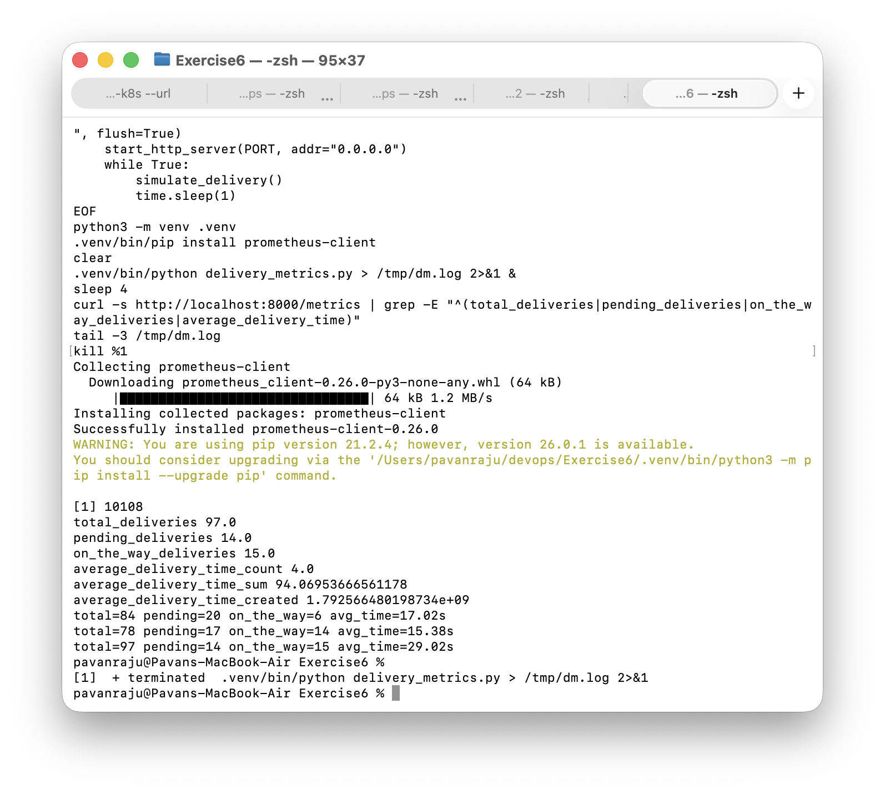
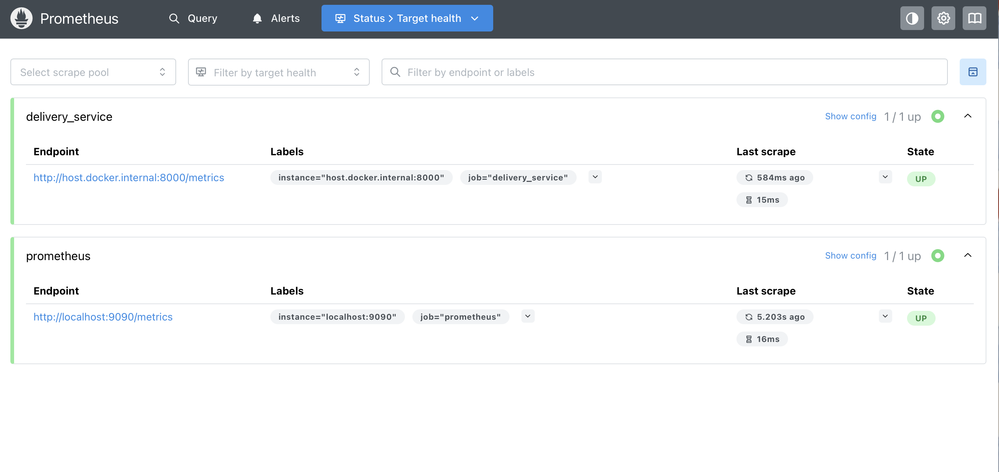
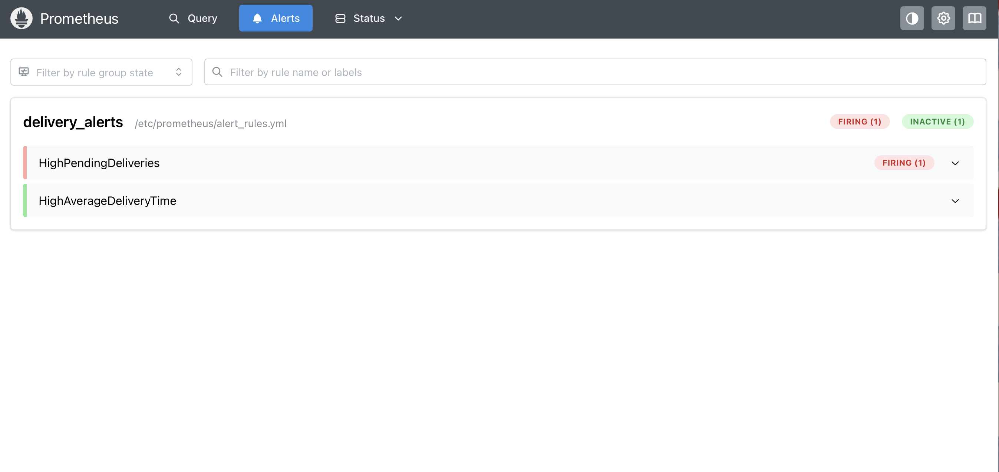
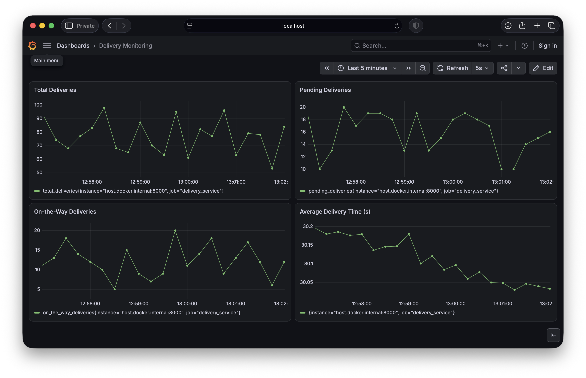
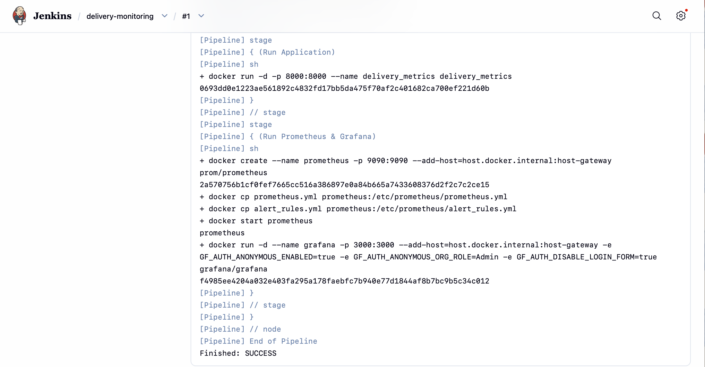
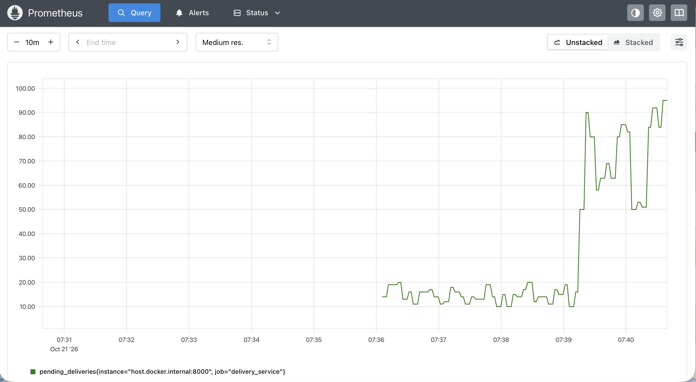
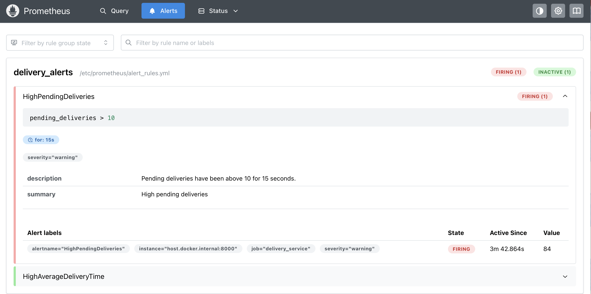

# Exercise 6: Real-Time Operations Monitoring and Alerting

## Objective

Build a monitoring pipeline for a delivery service: a Python application exposes simulated delivery metrics, Prometheus scrapes them and evaluates alert rules, Grafana visualises them on a dashboard, and a Jenkins pipeline automates deployment of the stack. Then raise the simulated load to trigger the alerts.

## Environment

- MacBook Air (Apple Silicon), macOS, zsh
- Docker Desktop for Mac (Docker 29.9.1)
- Python 3.9.6 locally, with `prometheus-client` 0.26.0 in a virtual environment
- Prometheus, Grafana 13 and Jenkins (LTS, JDK 17) running as Docker containers
- The metrics app inside its container runs on Python 3.12

## Adjustments for macOS and this machine

These differ from the exercise text, and are listed so the results are not misread:

- **Python version:** the exercise asks for Python 3.10 or higher, but the local Python is 3.9.6. The metrics library works on it, and the containerised app uses Python 3.12.
- **Prometheus target:** the target is `host.docker.internal:8000` instead of `172.17.0.1:8000`, and Prometheus is run with `-p 9090:9090` instead of `--network=host`. Docker Desktop for Mac has no `docker0` bridge on the host, and host networking does not expose services on the Mac.
- **Scrape interval:** set to 5 seconds (default 15 seconds) so graphs and alerts fill in quickly.
- **File name:** the exercise text mentions both `alerts_rules.yml` and `alert_rules.yml`. This submission uses `alert_rules.yml`, which is the name the Prometheus config refers to.
- **Alert simulation:** the pending-deliveries range is read from the environment variables `PENDING_MIN` and `PENDING_MAX` (default 10 and 20), so the 50 to 100 range could be set by restarting the container instead of editing the script.
- **Grafana setup:** the Prometheus data source and the four-panel dashboard were created through Grafana's HTTP API using `dashboard.json`, not by clicking through the UI. The result is the same dashboard.
- **Grafana login:** the browser login kept failing, so Grafana was recreated with anonymous access enabled (`GF_AUTH_ANONYMOUS_ENABLED`). This is fine for a local exercise and should not be used for anything exposed to a network. The Jenkins pipeline starts Grafana the same way.
- **Jenkins:** the stock Jenkins image has no Docker CLI, so `jenkins/Dockerfile` adds it, and the host's Docker socket is mounted so the pipeline can start containers. The setup wizard is skipped, and a startup script (`jenkins/create-job.groovy`) creates the pipeline job from the Jenkinsfile. Jenkins runs without a login, for local use only.
- **Dockerfile:** the exercise's pipeline runs `docker build` but does not provide a `Dockerfile`, so one was written for the metrics app.
- **Jenkinsfile:** it copies the project files from a mounted folder (`/src`), and uses `docker cp` to put the Prometheus configuration into the container, because bind-mount paths would point inside the Jenkins container and not on the host where the Docker daemon runs. The output of `docker info` is silenced so the host path does not appear in the build log.

## Tasks

### 1. Run the metrics application

    python3 -m venv .venv
    .venv/bin/pip install prometheus-client
    .venv/bin/python delivery_metrics.py
    curl -s http://localhost:8000/metrics

The application publishes `total_deliveries`, `pending_deliveries` and `on_the_way_deliveries` (gauges) and `average_delivery_time` (a summary, exposed as `_sum` and `_count`).

### 2. Prometheus and alert rules

    docker run -d --name prometheus -p 9090:9090 \
      --add-host=host.docker.internal:host-gateway \
      -v "$PWD/prometheus.yml:/etc/prometheus/prometheus.yml" \
      -v "$PWD/alert_rules.yml:/etc/prometheus/alert_rules.yml" \
      prom/prometheus

Both scrape targets (`prometheus` and `delivery_service`) report `UP`.

Both alert rules are loaded. With the default simulated range, `pending_deliveries` is between 10 and 20 and the threshold is 10, so `HighPendingDeliveries` fires straight away. `HighAverageDeliveryTime` stays inactive.

### 3. Grafana dashboard

    docker run -d --name grafana -p 3000:3000 \
      --add-host=host.docker.internal:host-gateway grafana/grafana

The Prometheus data source (`http://host.docker.internal:9090`) and the dashboard were created through the HTTP API from `dashboard.json`. The dashboard has four panels: Total Deliveries, Pending Deliveries, On-the-Way Deliveries, and Average Delivery Time (`average_delivery_time_sum / average_delivery_time_count`).

### 4. Jenkins pipeline

    docker build -t jenkins-delivery jenkins
    docker run -d --name jenkins --user root -p 8080:8080 \
      -v /var/run/docker.sock:/var/run/docker.sock \
      -v "$PWD":/src:ro jenkins-delivery

The pipeline job `delivery-monitoring` was created from the Jenkinsfile and run with Build Now. The stages are: Pre-check Docker, Setup Workspace, Clean Up Old Containers, Build Docker Image, Run Application, and Run Prometheus & Grafana. Build #1 finished with `SUCCESS`, and the pipeline started the metrics, Prometheus and Grafana containers. The `No such container` messages in the cleanup stage are expected on a first run.

The Grafana container started by the pipeline is a fresh one with no data source or dashboard. The dashboard screenshot above was taken before that, from the Grafana container started by hand.

### 5. Simulate alerts

The metrics container was restarted with a higher pending range:

    docker rm -f delivery_metrics
    docker run -d -p 8000:8000 -e PENDING_MIN=50 -e PENDING_MAX=100 \
      --name delivery_metrics delivery_metrics

After about 30 seconds `pending_deliveries` was 50 or more, and `HighPendingDeliveries` was firing. The graph shows the jump from the 10 to 20 band to the 50 to 100 band.

`HighAverageDeliveryTime` did not fire in the checks made. The simulated delivery time is random between 15 and 45 seconds, so its average stays close to the threshold of 30 and does not reliably cross it.

## Files

### Dockerfile

    FROM python:3.12-slim
    WORKDIR /app
    RUN pip install --no-cache-dir prometheus-client
    COPY delivery_metrics.py .
    EXPOSE 8000
    CMD ["python", "-u", "delivery_metrics.py"]

### delivery_metrics.py

    import os
    import random
    import time
    
    from prometheus_client import Gauge, Summary, start_http_server
    
    PORT = int(os.getenv("METRICS_PORT", "8000"))
    PENDING_MIN = int(os.getenv("PENDING_MIN", "10"))
    PENDING_MAX = int(os.getenv("PENDING_MAX", "20"))
    
    total_deliveries = Gauge("total_deliveries", "Total number of deliveries")
    pending_deliveries = Gauge("pending_deliveries", "Number of pending deliveries")
    on_the_way_deliveries = Gauge("on_the_way_deliveries", "Number of deliveries on the way")
    average_delivery_time = Summary("average_delivery_time", "Average delivery time in seconds")
    
    
    def simulate_delivery():
        pending = random.randint(PENDING_MIN, PENDING_MAX)
        on_the_way = random.randint(5, 20)
        delivered = random.randint(30, 70)
        avg_time = random.uniform(15, 45)
        total = pending + on_the_way + delivered
    
        total_deliveries.set(total)
        pending_deliveries.set(pending)
        on_the_way_deliveries.set(on_the_way)
        average_delivery_time.observe(avg_time)
    
        print(f"total={total} pending={pending} on_the_way={on_the_way} avg_time={avg_time:.2f}s", flush=True)
    
    
    if __name__ == "__main__":
        print(f"Starting metrics server on port {PORT} (pending range {PENDING_MIN}-{PENDING_MAX})", flush=True)
        start_http_server(PORT, addr="0.0.0.0")
        while True:
            simulate_delivery()
            time.sleep(1)

### prometheus.yml

    global:
      scrape_interval: 5s
      evaluation_interval: 5s
    
    scrape_configs:
      - job_name: "prometheus"
        static_configs:
          - targets: ["localhost:9090"]
    
      - job_name: "delivery_service"
        static_configs:
          - targets: ["host.docker.internal:8000"]
    
    rule_files:
      - /etc/prometheus/alert_rules.yml

### alert_rules.yml

    groups:
      - name: delivery_alerts
        rules:
          - alert: HighPendingDeliveries
            expr: pending_deliveries > 10
            for: 15s
            labels:
              severity: warning
            annotations:
              summary: "High pending deliveries"
              description: "Pending deliveries have been above 10 for 15 seconds."
    
          - alert: HighAverageDeliveryTime
            expr: (average_delivery_time_sum / average_delivery_time_count) > 30
            labels:
              severity: critical
            annotations:
              summary: "High average delivery time"
              description: "Average delivery time is above 30 seconds."

### Jenkinsfile

    pipeline {
        agent any
        stages {
            stage('Pre-check Docker') {
                steps {
                    sh 'docker --version'
                    sh 'docker info > /dev/null 2>&1'
                    echo 'Docker is installed and the daemon is reachable'
                }
            }
            stage('Setup Workspace') {
                steps {
                    sh 'cp /src/delivery_metrics.py /src/Dockerfile /src/prometheus.yml /src/alert_rules.yml "$WORKSPACE"/'
                    sh 'ls -l "$WORKSPACE"'
                }
            }
            stage('Clean Up Old Containers') {
                steps {
                    sh 'docker rm -f delivery_metrics prometheus grafana || true'
                }
            }
            stage('Build Docker Image') {
                steps {
                    sh 'docker build -t delivery_metrics .'
                }
            }
            stage('Run Application') {
                steps {
                    sh 'docker run -d -p 8000:8000 --name delivery_metrics delivery_metrics'
                }
            }
            stage('Run Prometheus & Grafana') {
                steps {
                    sh '''
                    docker create --name prometheus -p 9090:9090 \
                      --add-host=host.docker.internal:host-gateway prom/prometheus
                    docker cp prometheus.yml prometheus:/etc/prometheus/prometheus.yml
                    docker cp alert_rules.yml prometheus:/etc/prometheus/alert_rules.yml
                    docker start prometheus
                    docker run -d --name grafana -p 3000:3000 \
                      --add-host=host.docker.internal:host-gateway \
                      -e GF_AUTH_ANONYMOUS_ENABLED=true \
                      -e GF_AUTH_ANONYMOUS_ORG_ROLE=Admin \
                      -e GF_AUTH_DISABLE_LOGIN_FORM=true \
                      grafana/grafana
                    '''
                }
            }
        }
    }

### jenkins/Dockerfile

    FROM jenkins/jenkins:lts-jdk17
    USER root
    RUN ARCH=$(uname -m) && curl -fsSL https://download.docker.com/linux/static/stable/${ARCH}/docker-27.3.1.tgz | tar -xz --strip-components=1 -C /usr/local/bin docker/docker
    RUN jenkins-plugin-cli --plugins workflow-aggregator
    ENV JAVA_OPTS="-Djenkins.install.runSetupWizard=false"
    COPY create-job.groovy /usr/share/jenkins/ref/init.groovy.d/create-job.groovy

### jenkins/create-job.groovy

    import jenkins.model.Jenkins
    import org.jenkinsci.plugins.workflow.job.WorkflowJob
    import org.jenkinsci.plugins.workflow.cps.CpsFlowDefinition
    
    def jenkins = Jenkins.get()
    if (jenkins.getItem("delivery-monitoring") == null) {
        def job = jenkins.createProject(WorkflowJob, "delivery-monitoring")
        job.setDefinition(new CpsFlowDefinition(new File("/src/Jenkinsfile").text, true))
        job.save()
    }

`dashboard.json` holds the Grafana dashboard definition (four panels) used in step 3.

## Key Concepts

- **Prometheus** pulls metrics from targets on a schedule (scraping), stores them as time series, and evaluates alert rules against them.
- **Gauge and Summary:** a gauge is a value that can go up or down, such as pending deliveries. A summary records observations and exposes a running sum and count, which is how the average delivery time is computed.
- **Alert rules:** an alert fires when its expression is true. The `for` clause makes it wait before firing, so short spikes do not trigger it.
- **Grafana** queries Prometheus as a data source and turns the metrics into dashboard panels.
- **Jenkins pipeline:** a Jenkinsfile defines stages as code, so the whole stack can be built and deployed repeatably.
- **Docker Desktop networking:** containers reach services on the Mac through `host.docker.internal`, not through a host bridge address.

## Result

The metrics application, Prometheus, Grafana and Jenkins all ran as containers. Prometheus scraped both targets, the dashboard showed the four delivery metrics, and the Jenkins pipeline built and started the stack with a successful build. Raising the pending-deliveries range to 50 to 100 made the `HighPendingDeliveries` alert fire. `HighAverageDeliveryTime` stayed inactive in the checks made, because the simulated average delivery time sits near its threshold.
