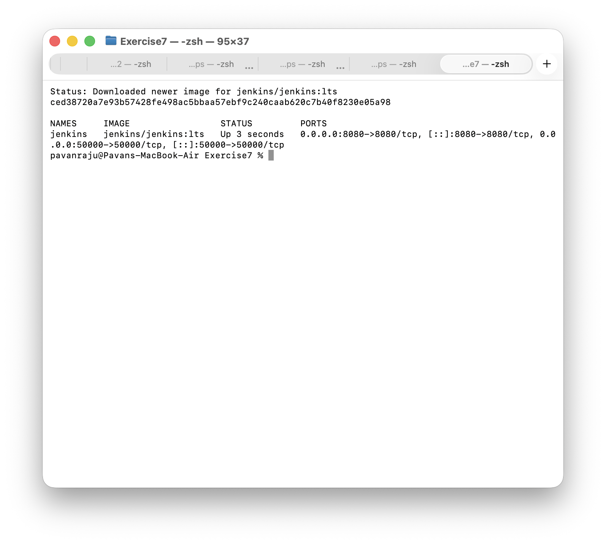
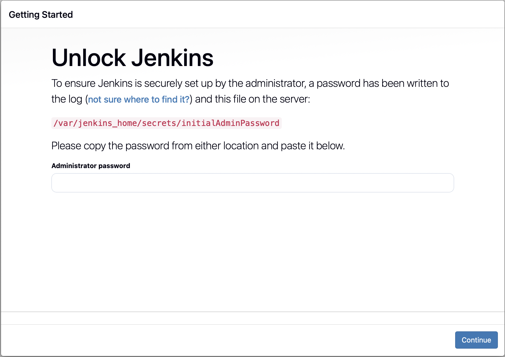
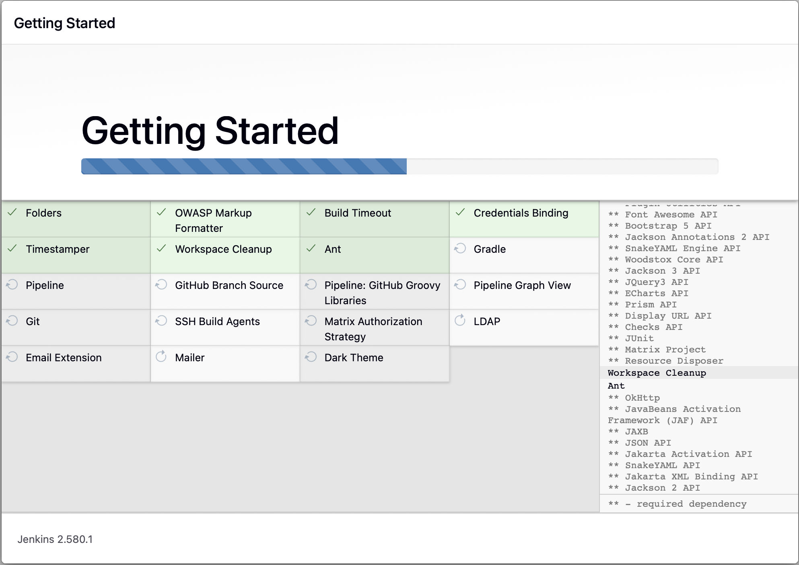
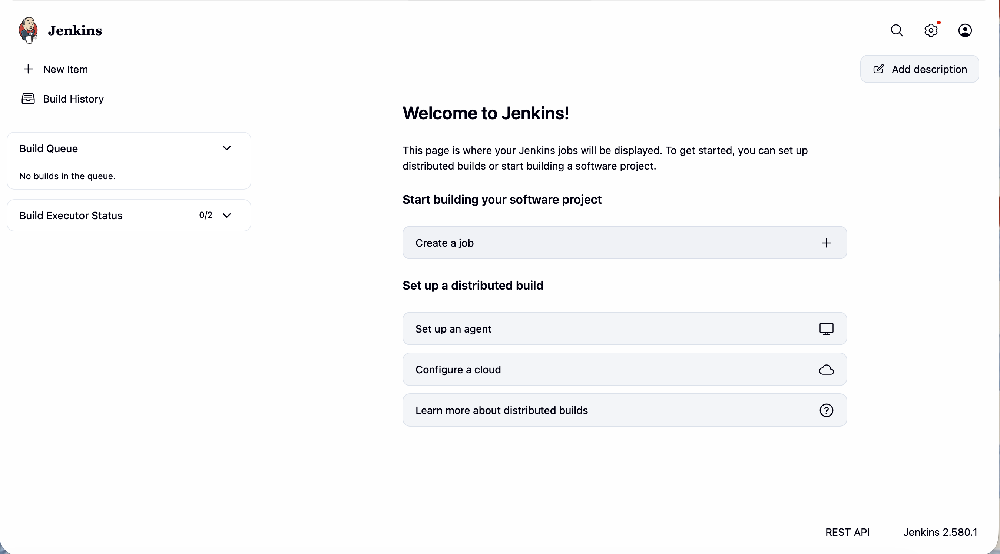

# Exercise 7: Introduction to Continuous Integration (CI) and Jenkins Installation

## Objective

Understand what Continuous Integration is and why teams use it, then install Jenkins in a Docker container and complete its first-time setup.

## Environment

- MacBook Air (Apple Silicon), macOS, zsh
- Docker Desktop for Mac (Docker 29.9.1)
- Jenkins LTS (`jenkins/jenkins:lts`), run as a Docker container

## Concepts

### Continuous Integration

Continuous Integration (CI) is the practice of merging every developer's changes into a shared repository often, and checking each change automatically. A CI server notices a new commit, builds the project, runs the automated tests, and reports back whether the change is safe. Problems show up within minutes of being introduced, while the change is still fresh in the author's mind, which makes them cheaper to fix than problems found at release time.

A typical CI flow:

1. A developer pushes code to a Git repository.
2. The CI server detects the push and starts a build.
3. The code is built and its dependencies are resolved.
4. Automated tests run.
5. The result (pass or fail) is sent back to the developer.

Common CI tools include Jenkins, GitLab CI/CD, GitHub Actions, CircleCI, TeamCity, Bamboo, Azure Pipelines, Buildkite and Drone. They differ mainly in whether they are hosted or self-managed, and in how they define pipelines (for example YAML files in the repository versus a server-side setup).

### Jenkins

Jenkins is an open-source automation server. It runs jobs that build, test and deploy software, which makes it a common choice for CI and continuous delivery. The terms used in this exercise:

- **Job or project:** a task that Jenkins runs.
- **Build:** one run of a job.
- **Pipeline:** a series of steps (build, test, deploy) defined as code.
- **Plugin:** an add-on that extends Jenkins, such as Git or Docker support.
- **Node:** a machine that runs jobs, either the controller itself or an agent.

## Tasks

### 1. Start Jenkins in Docker

    docker run -d --name jenkins -p 8080:8080 -p 50000:50000 jenkins/jenkins:lts
    docker ps --filter name=jenkins

Port 8080 serves the web interface and port 50000 is used by build agents connecting to the controller.

### 2. Open Jenkins and unlock it

Jenkins was opened at `http://localhost:8080`. On first start it asks for an administrator password, which Jenkins writes to a file inside the container. It can be read with a single command, without opening a shell in the container:

    docker exec jenkins cat /var/jenkins_home/secrets/initialAdminPassword

The password was copied straight to the clipboard and pasted into the page, so it does not appear in any screenshot. It is a one-time password for this local container.

### 3. Install the suggested plugins

After unlocking, "Install suggested plugins" was chosen. Jenkins downloaded and installed the standard set of plugins, which took a few minutes.

### 4. Finish setup and reach the dashboard

The first admin user step was completed and Jenkins showed that it was ready. The dashboard loaded.

## Notes

- The container was started without a volume, as in the exercise, so Jenkins' data lives only inside the container. If the container is deleted, the setup and the admin user are lost. For anything beyond an exercise, mount a volume such as `-v jenkins_home:/var/jenkins_home`.
- This installation is for local use. It is not secured or exposed beyond the local machine.

## Key Concepts

- **CI** catches integration problems early by building and testing every change automatically.
- **Jenkins** is a self-managed CI server that you run yourself and extend with plugins.
- **Containerising Jenkins** makes it quick to install and easy to remove, because everything lives in one container.
- **Port mapping:** `-p 8080:8080` publishes the container's web interface on the Mac's port 8080.

## Result

Jenkins was installed from the official Docker image, unlocked with its initial admin password, set up with the suggested plugins, and reached its dashboard at `http://localhost:8080`. This gives the working Jenkins server used for pipeline work in later exercises.
