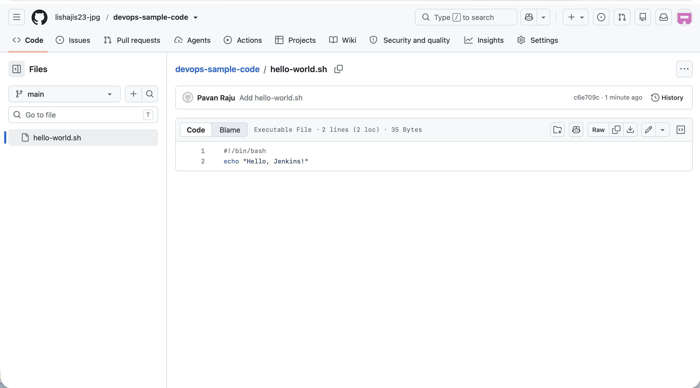
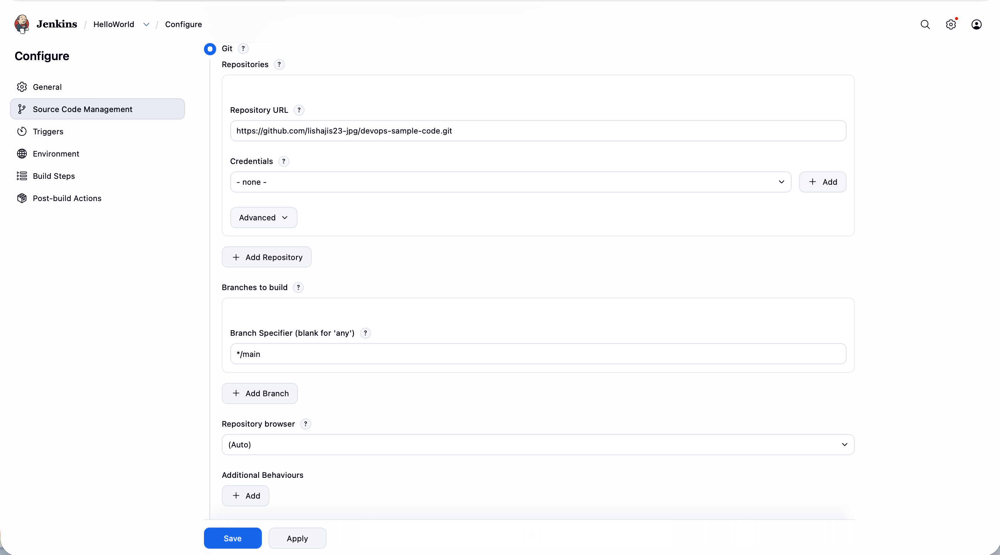
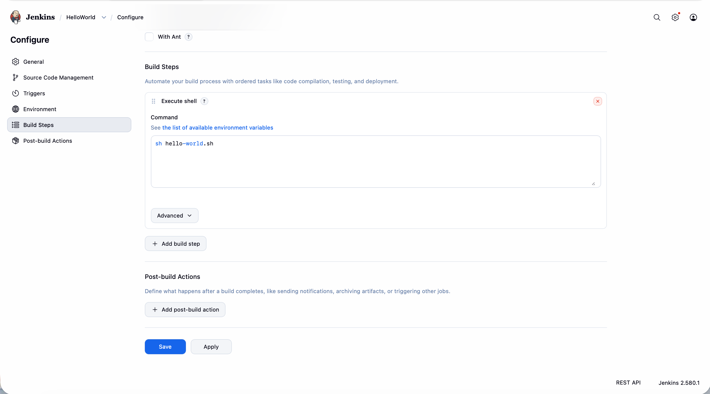
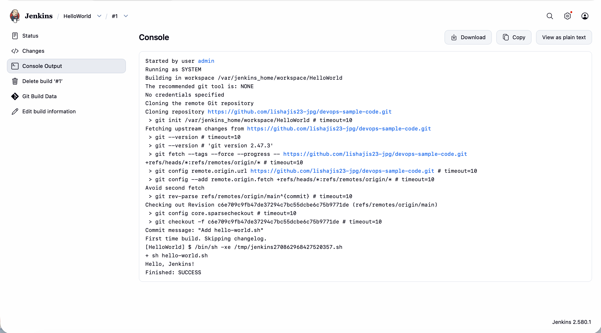

# Exercise 8: Creating a "Hello World" Jenkins Job

## Objective

Put a small shell script in its own GitHub repository, then create a Jenkins Freestyle job that checks the repository out and runs the script.

## Environment

- MacBook Air (Apple Silicon), macOS, zsh
- Docker Desktop for Mac
- Jenkins LTS (`jenkins/jenkins:lts`) in a Docker container, with the suggested plugins installed
- Script repository: https://github.com/lishajis23-jpg/devops-sample-code

## Adjustments and notes

- **Separate repository:** `devops-sample-code` is a different repository from this one, as the exercise requires. It was created locally in `~/devops-sample-code`, outside this repository, so that one Git repository is not nested inside another.
- **First push to `main`:** the exercise's repository starts empty, and an empty repository has no history to branch from, so the first commit was pushed directly to `main`. This repository (`devops`) still goes through a branch and a pull request.
- **Branch name:** the exercise runs `git init`, which creates `master` in older Git setups, and then pushes `main`. The local repository was created with `git init -b main` so the names match.
- **Authentication:** the push used the GitHub login already stored in the macOS keychain. No token is included in any file or screenshot.
- **Jenkins branch setting:** the Git section of the job defaults to `*/master`. It was changed to `*/main`, because the repository's branch is `main`. With the default, the build would fail.
- **Jenkins volume:** Jenkins was started with a named volume (`jenkins_home`) so its setup survives if the container is removed. The exercise's command has no volume.
- **Admin password:** the one-time initial password was copied to the clipboard and pasted into the unlock page, so it does not appear anywhere in this submission.

## Tasks

### 1. Create the script and push it to GitHub

An empty public repository named `devops-sample-code` was created on GitHub, with no README, `.gitignore` or licence. Then the script was written locally and pushed:

    mkdir -p ~/devops-sample-code && cd ~/devops-sample-code
    cat > hello-world.sh << 'EOS'
    #!/bin/bash
    echo "Hello, Jenkins!"
    EOS
    chmod +x hello-world.sh
    git init -b main
    git add hello-world.sh
    git commit -m "Add hello-world.sh"
    git remote add origin https://github.com/lishajis23-jpg/devops-sample-code.git
    git push -u origin main

`hello-world.sh` is now visible in the repository on GitHub:

### 2. Start Jenkins

    docker run -d --name jenkins -p 8080:8080 -p 50000:50000 \
      -v jenkins_home:/var/jenkins_home jenkins/jenkins:lts

Jenkins was opened at `http://localhost:8080`, unlocked with the initial admin password, and set up with the suggested plugins, which include the Git plugin that the job needs.

### 3. Create and configure the job

In Jenkins, **New Item** was used to create a **Freestyle project** named `HelloWorld`, with the description `Hello World! Jenkins job.` The configuration:

- **Source Code Management:** Git, repository URL `https://github.com/lishajis23-jpg/devops-sample-code.git`, no credentials (the repository is public), branch specifier `*/main`.
- **Build step:** Execute shell, with the command `sh hello-world.sh`.

### 4. Run the job and read the output

The job was saved and run with **Build Now**. In the console output of build #1, Jenkins cloned the repository, checked out `main`, ran `sh hello-world.sh`, and printed `Hello, Jenkins!`. The build finished with `Finished: SUCCESS`.

## The script

    #!/bin/bash
    echo "Hello, Jenkins!"

## Key Concepts

- **Freestyle project:** the simplest kind of Jenkins job, configured through forms: where to get the code, and what to run.
- **Source Code Management:** the part of a job that tells Jenkins which repository and branch to check out into its workspace before the build steps run.
- **Execute shell:** a build step that runs shell commands in the job's workspace, which here holds the cloned repository, so `hello-world.sh` is found by its relative path.
- **Workspace:** the folder Jenkins creates for each job, inside the container at `/var/jenkins_home/workspace/HelloWorld`.
- **Branch specifier:** it must match the repository's branch name, or the checkout fails.

## Result

The script was pushed to its own public repository, and a Jenkins Freestyle job checked it out and ran it successfully. Build #1 printed `Hello, Jenkins!` and finished with `Finished: SUCCESS`.
