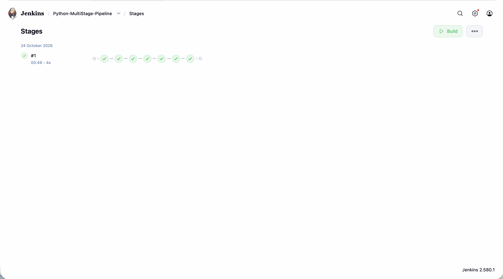
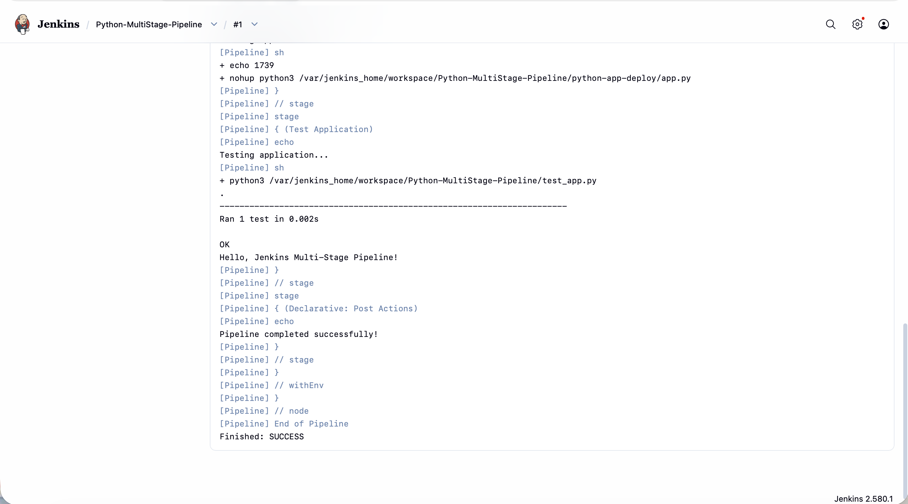

# Exercise 9: Jenkins Multi-Stage Pipeline for a Python Flask App

## Objective
Build and run a Jenkins declarative pipeline with several stages (Build, Test, Deploy, Run Application, Test Application) for a small Python Flask application, with the Jenkinsfile loaded from Git (Pipeline script from SCM).

The application code lives in a separate repo, as the exercise requires: https://github.com/lishajis23-jpg/devops-sample-code

## Environment
- MacBook Air (Apple Silicon), macOS
- Jenkins 2.580.1 running in Docker (image jenkins/jenkins:lts, container name jenkins, port 8080)
- Python 3.13.5 installed inside the Jenkins container with apt
- Flask 3.1.1 from apt (python3-flask) inside the container

## Tasks / Steps

### 1. Create the Flask app and tests
In ~/devops-sample-code I created app.py (a Flask app returning "Hello, Jenkins Multi-Stage Pipeline!"), test_app.py (a unittest that checks the home route) and requirements.txt.

I verified locally in a virtual environment first:

    python -m unittest discover -s .

### 2. Write the Jenkinsfile
The Jenkinsfile has five stages: Build (only prints a message), Test (runs python3 -m unittest discover -s .), Deploy (copies app.py into a python-app-deploy folder in the workspace), Run Application (starts the copied app in the background with nohup and saves its PID) and Test Application (runs test_app.py). A post block prints a success or failure message.

### 3. Push through a branch and PR
The files were committed on branch exercise9 and merged into main through a pull request, so Jenkins could check out origin/main.

### 4. Prepare Jenkins
The Jenkins container has no Python by default, so the first build would fail. I installed it as root inside the container:

    docker exec -u root jenkins bash -c "apt-get update && apt-get install -y python3 python3-pip python3-venv python3-flask"
    docker exec jenkins python3 --version

### 5. Create the pipeline job
In Jenkins: New Item, name Python-MultiStage-Pipeline, type Pipeline. Under Pipeline I chose Pipeline script from SCM, SCM Git, repository https://github.com/lishajis23-jpg/devops-sample-code.git, branch */main, script path Jenkinsfile, no credentials (public repo).

### 6. Run the pipeline
I clicked Build Now. Build #1 finished with SUCCESS.

Stage view (the 7 circles are the 5 stages in the Jenkinsfile plus Jenkins' automatic Declarative: Checkout SCM and Declarative: Post Actions steps):

Console output (last part of the log, showing the tests passing and Finished: SUCCESS):

## Deviations and honest notes
- requirements.txt contains an extra pin, Werkzeug==2.2.3, which is not in the exercise. Flask 2.1.2 breaks with newer Werkzeug versions, so I pinned it to make my local tests pass.
- The Build stage only echoes a message, exactly as in the exercise, and never runs pip install. So Jenkins tested with the Flask 3.1.1 installed by apt in the container, not the Flask 2.1.2 pinned in requirements.txt.
- The apt install also pulled in extra packages such as build-essential as dependencies.
- The exercise text says the app is deployed to /tmp/python-app-deploy, but the Jenkinsfile deploys to the python-app-deploy folder inside the Jenkins workspace, and I followed the Jenkinsfile.
- The Test Application stage re-runs the unit test through Flask's test client. It does not send a request to the app started in the Run Application stage.
- The optional enhancements (flake8 code quality stage, Docker deployment, email or Slack notifications) were not done.

## Key Concepts
- Declarative pipeline: stages and steps defined in a Jenkinsfile kept in version control.
- Pipeline script from SCM: Jenkins pulls the Jenkinsfile from Git on every build.
- Stages give a clear view of where a build fails.
- Jenkins agents need their own tools: the container needed Python installed before the Test stage could work.
- The WORKSPACE variable points to the job's working directory inside Jenkins.

## Result
The pipeline ran all stages successfully. The unit test passed (Ran 1 test, OK), the application file was deployed to the workspace, and the build ended with Finished: SUCCESS.
